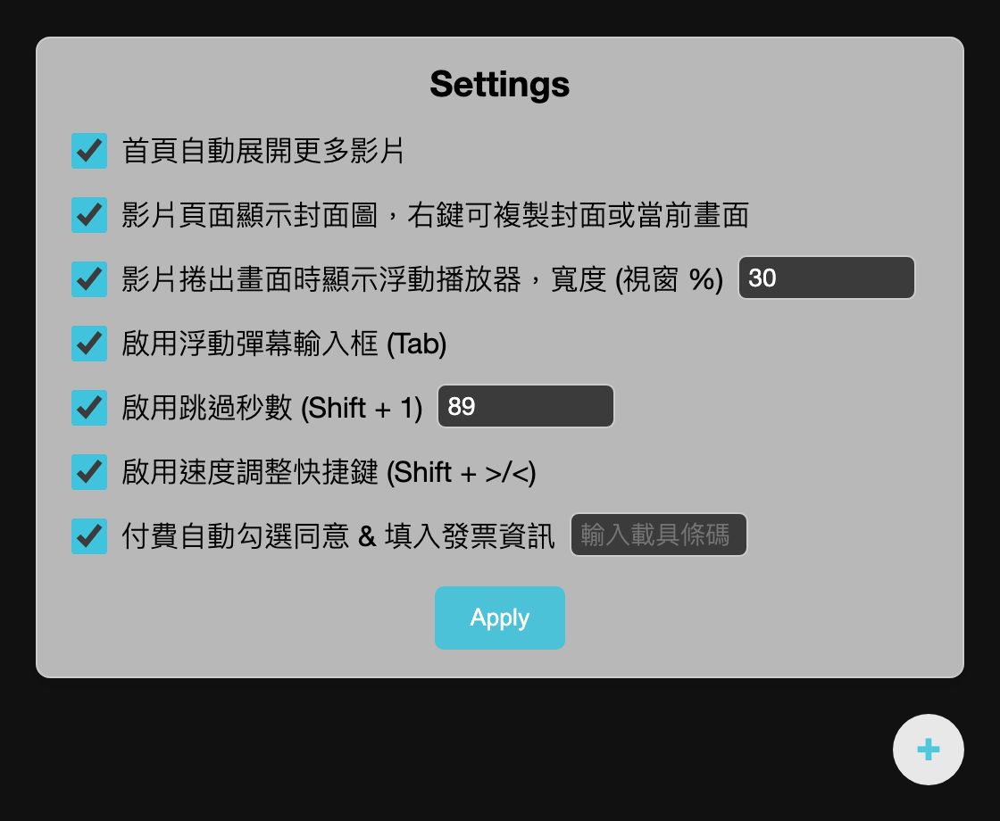

# AniGamerKit

AniGamerKit 是一套用於[巴哈姆特動畫瘋](https://ani.gamer.com.tw/)的 userscript，提供浮動播放器、彈幕輸入、影片快捷鍵與付款頁面輔助功能。

點擊頁面右下角的 `+` 開啟設定面板，可透過開關啟用或停用功能。按下 `Apply` 後重新載入頁面即可套用。

## 安裝

安裝 [Tampermonkey](https://www.tampermonkey.net/) 後，開啟下列連結安裝最新版：

<https://github.com/akalivaty/anigamerkit/releases/latest/download/anigamer_kits.user.js>

從這個連結安裝的腳本會自動檢查 GitHub Releases 並更新。若先前是用本機檔案安裝，請從上面的連結重新安裝一次，之後才會自動更新。

## 功能




- [x] 首頁自動展開更多動畫。
- [x] 影片頁面顯示封面圖；在播放器上按右鍵可「複製封面圖片」或「複製封面網址」，開始播放後（播放中或暫停）還可「複製當前畫面」，以影片原始解析度複製按下右鍵那一刻的畫面，不含彈幕與控制列；廣告播放時不提供。選單會跟隨網站的深色模式；按住 `Shift` 再按右鍵可使用瀏覽器原本的選單。
- [x] 站內換集（播放完畢按「下一集」或點選集數）時顯示下一集的預覽圖，修正動畫瘋停在上一集最後一格畫面的問題。
- [x] 影片捲出畫面時顯示右下角浮動播放器。
- [x] 按下 `Tab` 開啟置中的浮動彈幕輸入框，支援一般、浮動與全螢幕播放。
- [x] 按下 `Shift + 1` 快轉指定秒數，預設為 89 秒，適合略過常見的 OP／ED 長度。
- [x] 按下 `Shift + >` 或 `Shift + <` 調高或降低播放速度。
- [x] 付款頁面自動勾選同意項目，並可自動填入手機條碼載具。

## 浮動播放器

浮動播放器是網頁內的懸浮視窗，不使用瀏覽器原生 Picture-in-Picture API，因此不需要額外的 PIP 權限或使用者手勢。它只會顯示在目前動畫瘋頁面內，切換分頁或其他應用程式後不會保持在最上層。

### 自動浮動

- 影片正在播放，且原播放器可見高度低於 50% 時，自動移到右下角。
- 原播放器位置恢復至少 60% 可見時，回到原位。
- 50%～60% 之間維持目前狀態，避免在門檻附近反覆切換。
- 浮動後即使影片暫停或播放結束，仍會留在目前位置，直到畫面捲回原播放器。
- 進入全螢幕時會先退出浮動模式。
- 原位置會保留等高空間，避免頁面突然跳動。
- 彈幕輸入框（`Tab`）、播放速度提示與換集預覽圖都會跟著浮動播放器顯示。

### 大小與位置

- 預設寬度為視窗寬度的 30%，可在設定面板調整（10%～100%），高度依影片長寬比自動計算。
- 設定的寬度放不進設定按鈕上方的空間時，會等比例縮小到放得下為止。
- 每次進入浮動模式都會回到右下角、設定按鈕上方，並使用設定的寬度。
- 浮動中按下 `Apply` 會立即套用新寬度，並把播放器移回右下角。
- 設定面板展開時會疊在浮動播放器上方，不會被擋住。

### 移動與縮放

- 除了按鈕、連結、輸入框、Video.js 控制列及縮放區域外，整個浮動播放器都可以拖曳；移動少於 5px 視為點擊，仍可正常播放／暫停。
- 拖曳位置會限制在瀏覽器可視範圍內，不會將播放器移出畫面。
- 四個角落都可以調整大小，縮放時維持長寬比，並固定對角的位置；最小約 240 × 135px。
- 縮放熱區平常保持透明；滑鼠移入播放器時，四角才會顯示半透明的 L 型角標。
- 調整瀏覽器視窗大小時保留目前位置；若沒有手動縮放過，寬度會依新視窗重新計算，手動縮放過則維持手動的大小。

## Build

需要 Node.js 18 或更新版本，不需要安裝額外套件。

```sh
npm run build
```

建置完成後，將 `dist/anigamer_kits.user.js` 匯入 Tampermonkey。產出的 userscript 已包含所有來源模組，不使用本機 `@require` 路徑。

`npm run build` 也會用本機的 Chrome（headless）依建置結果重新產生 `img/setting_panel.png`，所以設定面板有變動時，README 的截圖會自動更新。截圖使用預設設定與動畫瘋深色主題的樣式，只在 bundle 變動時重新產生，畫面沒變就不會改寫檔案。找不到 Chrome 時會略過（可用 `CHROME_PATH` 指定路徑），CI 中也會略過。

本機開發時請修改專案根目錄的來源檔案，再重新執行 `npm run build`。請勿將根目錄的 `anigamer_kits.user.js` 直接匯入 Tampermonkey；該檔案是 bundle 入口，實際可安裝檔案位於 `dist/anigamer_kits.user.js`。

## Release

`package.json` 是版本號的唯一來源。請先提交功能或修正，再從乾淨的 worktree 執行其中一個版本命令：

```sh
npm run release:patch
npm run release:minor
npm run release:major
```

版本命令會更新 `package.json`、同步 userscript 的 `@version`、執行所有檢查、重新建置輸出檔、建立版本 commit，並建立對應的 `vX.Y.Z` Git tag。命令不會自動推送到遠端。

完成一項功能後的發布流程範例：

```sh
npm run check
git add .
git commit -m "feat: describe the change"
npm run release:patch
git push origin main --follow-tags
```

推送 Git tag 後會觸發 `.github/workflows/release.yml`。GitHub Actions 會確認 tag 與 `package.json` 的版本一致、建置 userscript、建立 GitHub Release，並將 `dist/anigamer_kits.user.js` 上傳為 release asset。
